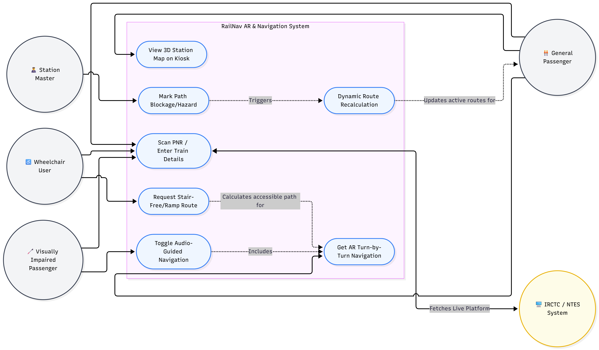

# Smart India Hackathon Workshop
# Date: 29-10-2026
## Register Number:212224040297
## Name:SARANYA AV
## Problem Title
SIH 1710: Enhancing Navigation for Railway Station Facilities and Locations
## Problem Description
Background: Railway stations are complex environments with numerous facilities and locations such as ticket counters, platforms, restrooms, food courts, and waiting areas. Passengers often face difficulties in navigating these spaces, especially in large or unfamiliar stations. Efficient and user-friendly navigation systems are crucial for improving passenger experience, reducing congestion, and ensuring timely travel connections. Description: The problem involves developing a comprehensive navigation solution for railway stations that assists passengers in locating various facilities and destinations within the station premises. This includes creating detailed maps, providing real-time directions, and integrating features such as accessibility options for individuals with disabilities. The solution should be intuitive, easy to use, and accessible via multiple platforms, including mobile devices and digital kiosks. Key challenges include updating navigation information in real-time, ensuring accuracy, and accommodating the diverse needs of all passengers. Expected Solution: The expected solution is a multi-platform navigation system that provides detailed, real-time directions to all facilities and locations within a railway station. This system should include: A mobile application with 3D interactive maps and step-by-step navigation. Digital kiosks located throughout the station with touch-screen interfaces. Voice-guided navigation for visually impaired passengers. Regular updates to reflect changes in station layout and facility locations. Integration with existing railway apps and services for seamless user experience. The solution should enhance the overall passenger experience by reducing confusion, saving time, and improving accessibility within the station.

## Problem Creater's Organization
Ministry of Railway

## Idea

"RailNav AR: A Digital Twin & Augmented Reality Navigation Ecosystem"

Traditional GPS fails indoors. Our idea is to create a "Digital Twin" of the railway station utilizing an Indoor Positioning System (IPS) powered by Bluetooth Low Energy (BLE) beacons and Wi-Fi RTT.

We will provide passengers with an Augmented Reality (AR) mobile application that projects directional arrows directly onto their phone’s camera view. For passengers without smartphones, we will deploy Interactive 3D Touch Kiosks. To ensure inclusivity, the app will feature a Voice-First AI Assistant (available in regional languages) providing turn-by-turn auditory feedback specifically designed for visually impaired users (Divyangjan), calculating paths that avoid stairs and prioritize elevators.

## Proposed Solution / Architecture Diagram

1. The User Interfaces (Front-End):

AR Mobile App: Users scan their PNR, and the app instantly calculates the shortest path to their designated coach position, platform, or preferred food court.

Digital Kiosks: Large touchscreens at station entrances showing a 3D WebGL map. Users can scan a QR code on the kiosk to seamlessly transfer the route to their mobile phone.

Station Master Dashboard: A web portal for railway staff to update the map in real-time (e.g., blocking off a restroom for cleaning or a corridor for maintenance), which instantly reroutes passengers.

2. The Backend & Routing Engine:

Uses a Graph Database (nodes = locations, edges = paths) running the A* (A-Star) pathfinding algorithm.

Microservices architecture for handling user location tracking, route calculation, and real-time station updates.

## Use Cases

The Rushed Traveler (PNR Integration): A passenger arrives 10 minutes before departure. They enter their PNR; the app identifies their train is on Platform 4, Coach S5, and provides the fastest AR route directly to the exact coach location.

Visually Impaired Passenger (Accessibility): A visually impaired user switches the app to "Audio Mode." Utilizing TalkBack/VoiceOver, the app uses spatial audio cues ("Turn slightly left in 10 steps") to guide them safely to the ticketing counter.

Wheelchair User (Smart Routing): The passenger selects "Wheelchair Access." The graph algorithm dynamically drops all routes containing stairs or escalators and recalculates a path using ramps and elevators.

Real-Time Hazard Avoidance: A spill occurs on Foot Over Bridge 1. The station master marks it as "Blocked" on the admin dashboard. The system instantly recalculates active routes for all users in the station to use Foot Over Bridge 2.

## Technology Stack

Mobile Application (Cross-Platform): Flutter / Dart

Augmented Reality (AR): Google ARCore / Apple ARKit

Kiosk Web App / 3D Mapping: React.js, Three.js (WebGL), Mapbox GL

Backend API & Microservices: Node.js (Express) or Python (FastAPI)

Database (Routing & User Data): Neo4j (Graph Database for lightning-fast routing algorithms) and MongoDB (NoSQL)

Indoor Positioning Hardware: Bluetooth Low Energy (BLE) iBeacons / Eddystone Beacons

Cloud & DevOps: AWS / Google Cloud, Docker (for containerized deployment)

## Dependencies

Hardware Infrastructure: Procurement and installation of BLE Beacons every 10-15 meters across the station ceiling/walls for accurate indoor triangulation.

Station Data (CAD files): Access to architectural blueprints or digital floor plans from the Ministry of Railways to create accurate 3D models and routing graphs.

Third-Party API Integration: Access to the NTES (National Train Enquiry System) or IRCTC API for real-time train platform assignments and PNR status.

Internet Connectivity: While basic routing can be cached offline, real-time updates require passengers to have mobile data or access to RailWire Free Wi-Fi.
